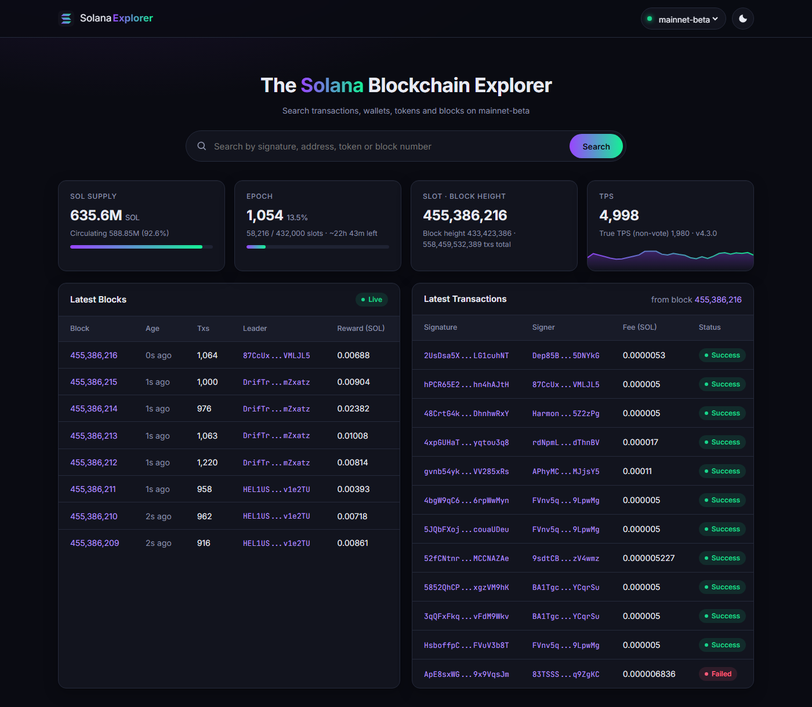
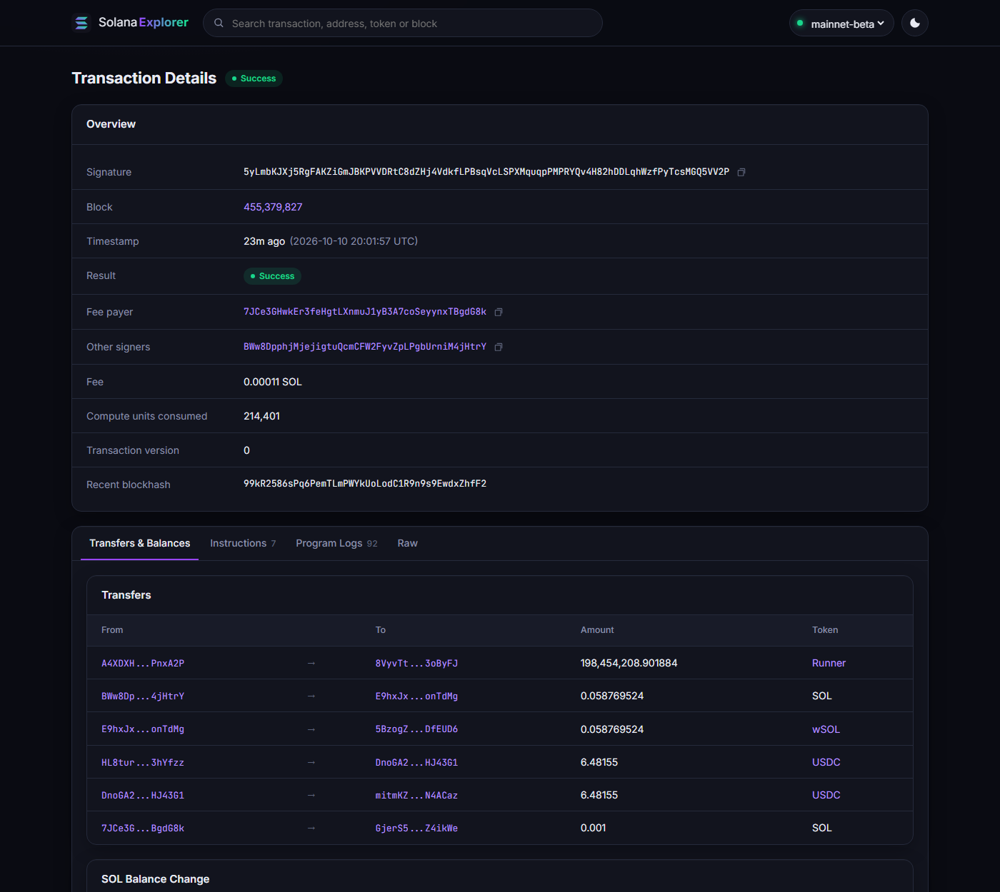
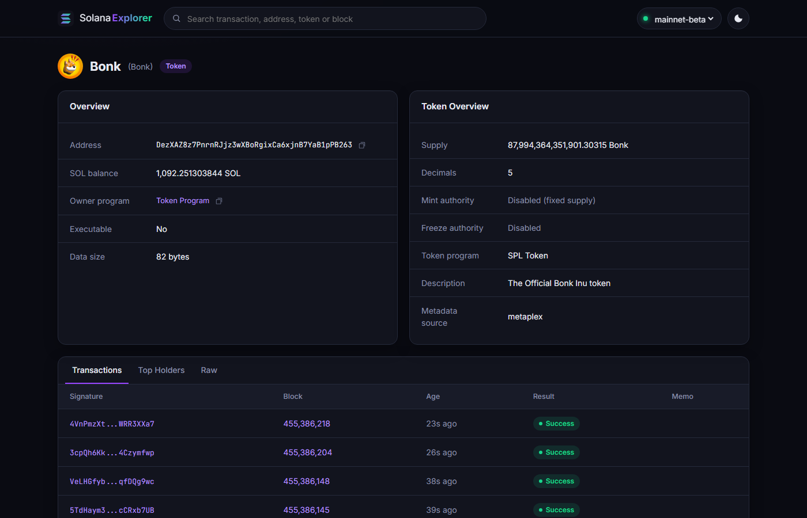

<div align="center">

# Solana Explorer

**A Solscan-style Solana block explorer you run on your own machine, plus a CLI, a desktop GUI and a Python API.**

[](https://github.com/CryptGodSon/Solana-Explorer/actions/workflows/ci.yml)

[](LICENSE)

</div>

Solana Explorer talks directly to any Solana JSON-RPC node and turns the raw
responses into readable pages and reports: live network stats, blocks,
transactions with decoded SOL and SPL-token transfers, balance changes, the full
instruction tree, wallets with their token holdings, and token pages with logos,
supply and top holders. It has a single runtime dependency (`requests`) and needs
no API key.

<p align="center"></p>

## Features

**Web explorer** (`solana-explorer web`)

- **Dashboard** with SOL supply, epoch progress and ETA, slot and block height, TPS (total and non-vote) with a live chart, latest blocks and latest non-vote transactions, refreshed automatically
- **Transaction pages**: overview, transfers, SOL and token balance changes, expandable instructions with decoded arguments, program logs, and raw JSON
- **Account pages** that recognise wallets, token mints, token accounts, programs, and vote and stake accounts, with paginated history and token holdings
- **Token pages**: name, symbol and logo (from Metaplex or Token-2022 metadata), supply, authorities, extensions, and top holders
- **Block pages** with leader, rewards and a transaction list that can hide vote transactions
- One search box for signatures, addresses, tokens and block numbers; cluster switcher; dark and light themes; works on phones
- Shareable URLs like Solscan (`/tx/<sig>`, `/account/<address>`, `/block/<slot>`, with `#logs` style deep links to tabs)

**Everywhere** (CLI, GUI, Python API)

- **Transaction details**: status and error, slot, block time, fee, compute units, signers, version (legacy, v0 and v1+)
- **Decoded transfers**: SOL transfers and SPL Token / Token-2022 `transfer` and `transferChecked`, including transfers made by inner instructions (for example inside DEX swaps)
- **Balance changes**: per-account SOL and token deltas, computed from pre/post balances
- **Instruction tree**: top-level and inner instructions in execution order, with well-known programs labelled (System, Token, Jupiter, Raydium, Orca and others)
- **Account lookup**: SOL balance, owner program, data size, plus token-account and mint details
- **Address history**: the most recent signatures for any address
- **Batch mode**: many signatures at once, from arguments, a file, or stdin. One bad input does not stop the batch.
- **JSON output** for scripting (`--json`)
- **Desktop GUI** (tkinter) that keeps working while requests run in the background
- **Any cluster**: mainnet-beta, devnet, testnet, or a custom RPC URL
- **Robust networking**: timeouts, retry with exponential backoff on HTTP 429/5xx, and an in-memory LRU cache for transactions you already fetched
- **Input validation**: signatures and addresses are checked (base58, correct byte length) before any request is sent

## Installation

Requires **Python 3.10+**.

```bash
# Recommended: install as an isolated command-line tool
pipx install git+https://github.com/CryptGodSon/Solana-Explorer.git

# or with pip
pip install git+https://github.com/CryptGodSon/Solana-Explorer.git
```

This installs `solana-explorer` (the CLI and the `web` command) and `solana-explorer-gui` (the desktop app).

<details>
<summary>Install from a local clone</summary>

```bash
git clone https://github.com/CryptGodSon/Solana-Explorer.git
cd Solana-Explorer
python -m venv .venv
source .venv/bin/activate        # Windows: .venv\Scripts\activate
pip install -e .
```

</details>

> **Linux:** the GUI needs tkinter. If `python -m tkinter` fails, install it with `sudo apt install python3-tk` (Debian/Ubuntu) or `sudo dnf install python3-tkinter` (Fedora). The CLI works without it.

## Web explorer

```bash
solana-explorer web                      # opens http://127.0.0.1:8000 in your browser
solana-explorer web --cluster devnet     # start on devnet
solana-explorer web --rpc-url https://my-rpc.example.com --port 9000 --no-browser
```

| Transaction | Token |
| --- | --- |
|  |  |

The server listens on `127.0.0.1` only. It answers only requests whose `Host`
header is a loopback name, which blocks DNS-rebinding attacks, and it serves a
strict Content-Security-Policy. Use `--host 0.0.0.0` only if you deliberately
want other machines on your network to reach it.

> The public `api.mainnet-beta.solana.com` endpoint is rate-limited. The explorer
> caches heavily, but heavy methods such as top token holders may still be refused.
> For a smooth experience, pass your own RPC URL with `--rpc-url` or `SOLANA_RPC_URL`.

## Quick start (CLI)

```bash
solana-explorer tx 5gg257Zuqdn5uuFcbMFo6ZqoSSzXWdZiKKqcTaRKV9diiAJ9LNzV1c2G9uMJ2MpRVhCcjAFP7Q9U7naZpq6VgLuS
```

```text
Transaction 5gg257Zuqdn5uuFcbMFo6ZqoSSzXWdZiKKqcTaRKV9diiAJ9LNzV1c2G9uMJ2MpRVhCcjAFP7Q9U7naZpq6VgLuS
  Status:          Success
  Slot:            455,377,377
  Block time:      2026-10-10 19:53:03 UTC
  Fee:             0.000008864 SOL
  Compute units:   105,723
  Version:         0
  Fee payer:       5K7F3zfEauuNwMBZRXUnxBeGUZorGnftG79pohtdG4NK
  Explorer:        https://explorer.solana.com/tx/5gg257Zu...

Transfers (6)
  0.000235327 SOL
      5K7F3zfEauuNwMBZRXUnxBeGUZorGnftG79pohtdG4NK -> 4QSJJjNkfqRnyJdxM4Ug1ooR2gA2kuB9qEBMRshBpRPK
  5,467.66769 PHgCReUnUsk1jUTVzBZUV5SDSmCyTT4ZVDAEkQZgoa2
      6faFWKVNTkijvLd5Ws8jj5TJpjnGNNfVQCiX19JZLssj -> GgkmHp1DqxQfVGYBaUZXk6NNpz3a3EiEYUNgmsMyPKJs
  ...

Instructions (20)
  #1     Compute Budget Program
  #3     Associated Token Account Program: createIdempotent
    #3.1   Token Program: getAccountDataSize
  ...
  #6     Jupiter Aggregator v6
    #6.3   Token-2022 Program: transferChecked
  ...
```

## CLI usage

| Command | What it does |
| --- | --- |
| `solana-explorer tx SIG [SIG ...]` | Show one or more transactions |
| `solana-explorer tx --file sigs.txt` | Read signatures from a file (`-` reads stdin), one per line or comma-separated |
| `solana-explorer tx SIG --logs` | Also print program log messages |
| `solana-explorer account ADDRESS` | Balance, owner, and token-account or mint details |
| `solana-explorer history ADDRESS -n 25` | The latest 25 signatures for an address (`--before SIG` to page back) |
| `solana-explorer web` | Start the browser-based explorer (`--port`, `--host`, `--no-browser`) |
| `solana-explorer gui` | Open the desktop app |

Options available on every command:

| Option | Description |
| --- | --- |
| `-c, --cluster NAME` | `mainnet-beta` (default), `devnet` or `testnet` |
| `-u, --rpc-url URL` | Use a custom RPC endpoint |
| `--timeout SEC` | Per-request timeout (default: 15) |
| `--json` | Machine-readable output (not on `gui`) |

Exit codes: `0` success, `1` at least one lookup failed, `2` invalid input.

### Scripting examples

```bash
# Fee paid by a transaction, using jq
solana-explorer tx <SIG> --json | jq -r .fee_sol

# Check the latest 50 transactions of an address and print the failed ones
solana-explorer history <ADDRESS> -n 50 --json | jq -r '.[] | select(.success | not) | .signature'

# Pipe signatures in from another tool
cat signatures.txt | solana-explorer tx --file - --cluster devnet
```

## Desktop GUI

```bash
solana-explorer-gui            # or: solana-explorer gui --cluster devnet
```

Paste one or more **transaction signatures or account addresses** (the app detects
which is which), choose a cluster or type an RPC URL, and press **Explore** or
<kbd>Ctrl</kbd>+<kbd>Enter</kbd>. Addresses show the account summary and its 10
most recent transactions. Requests run on a background thread, so the window
stays responsive.

## Python API

```python
from solana_explorer import SolanaExplorer

explorer = SolanaExplorer(endpoint="mainnet-beta")  # or "devnet", or an RPC URL

tx = explorer.get_transaction("5gg257Zu...")
print(tx.success, tx.fee_sol, tx.block_time)
for t in tx.transfers:
    print(t.asset, t.amount, t.mint, t.source, "->", t.destination)

# Batch lookup: errors are returned per signature instead of raised
for result in explorer.get_transactions(["sig1", "sig2"]):
    print(result.signature, "ok" if result.ok else result.error)

account = explorer.get_account("EPjFWdd5AufqSSqeM2qN1xzybapC8G4wEGGkZwyTDt1v")
print(account.balance_sol, account.owner, account.account_type)

history = explorer.get_signatures("JUP6LkbZbjS1jKKwapdHNy74zcZ3tLUZoi5QNyVTaV4", limit=5)
```

All models are frozen dataclasses with a `to_dict()` method that returns JSON-safe
data. Errors derive from `SolanaExplorerError` (`InvalidInputError`,
`TransactionNotFoundError`, `RpcError`, `RpcTransportError`).

## Configuration

| Setting | How |
| --- | --- |
| RPC endpoint | `--cluster`, `--rpc-url`, or the `SOLANA_RPC_URL` environment variable |
| Default | `https://api.mainnet-beta.solana.com` |

The public Solana endpoints are rate-limited and keep only limited transaction
history. For heavy use, or for transactions that are months or years old, use a
dedicated RPC provider and pass its URL with `--rpc-url` or `SOLANA_RPC_URL`.

## How it works

The tool uses only standard Solana JSON-RPC methods: `getTransaction`,
`getBlock`, `getBlocks`, `getAccountInfo`, `getMultipleAccounts`,
`getSignaturesForAddress`, `getTokenAccountsByOwner`, `getTokenLargestAccounts`,
`getEpochInfo`, `getRecentPerformanceSamples`, `getSupply` and `getVersion`.
Token names come from the Metaplex metadata account (its address is derived
locally, with a pure-Python ed25519 curve check) or from the Token-2022 metadata
extension. Logos are read from the off-chain JSON the metadata points to, which
is never fetched from private or loopback addresses. Legacy,
v0 and newer transaction versions are all supported: if the node reports that a
transaction needs a higher `maxSupportedTransactionVersion`, the client retries
with that version and uses it from then on. Transfers are decoded from the node's
parsed instructions. For a plain SPL `transfer`, which carries no mint, the mint
and decimals are recovered from the transaction's token balances. For a failed
transaction, the transfers are listed as attempted and reverted, because a
failed transaction moves no funds apart from the fee.

## Project structure

```text
Solana-Explorer/
├── src/solana_explorer/
│   ├── cli.py          # argparse CLI (tx / account / history / gui)
│   ├── web/
│   │   ├── server.py   # local HTTP server: JSON API + single-page app
│   │   └── static/     # index.html, app.js, style.css (no build step)
│   ├── gui.py          # tkinter desktop app
│   ├── explorer.py     # high-level API: validation, caching, batch lookups
│   ├── rpc.py          # JSON-RPC client with retries and cluster resolution
│   ├── models.py       # typed dataclasses and RPC response parsing
│   ├── formatting.py   # plain-text reports shared by the CLI and GUI
│   ├── metadata.py     # token names/logos (Metaplex, Token-2022), PDA derivation
│   ├── validation.py   # base58 signature and address validation
│   ├── cache.py        # thread-safe LRU cache
│   ├── constants.py    # clusters, well-known programs and tokens
│   └── errors.py       # exception hierarchy
├── tests/              # pytest suite (no network access needed)
├── docs/images/        # screenshots used in this README
├── .github/workflows/  # CI: ruff + pytest on Linux, Windows and macOS
└── pyproject.toml
```

## Development

```bash
pip install -e ".[dev]"
pytest              # run the test suite
ruff check .        # lint
ruff format .       # format
```

The tests use recorded RPC fixtures and fake clients, so they run offline in well under a second.

## Contributing

Contributions are welcome:

1. Fork the repository and create a feature branch.
2. Add or update tests for your change.
3. Make sure `pytest` and `ruff check .` pass.
4. Open a pull request that describes what changed and why.

Bug reports and feature ideas are welcome in [Issues](https://github.com/CryptGodSon/Solana-Explorer/issues).

## License

Released under the [MIT License](LICENSE).
